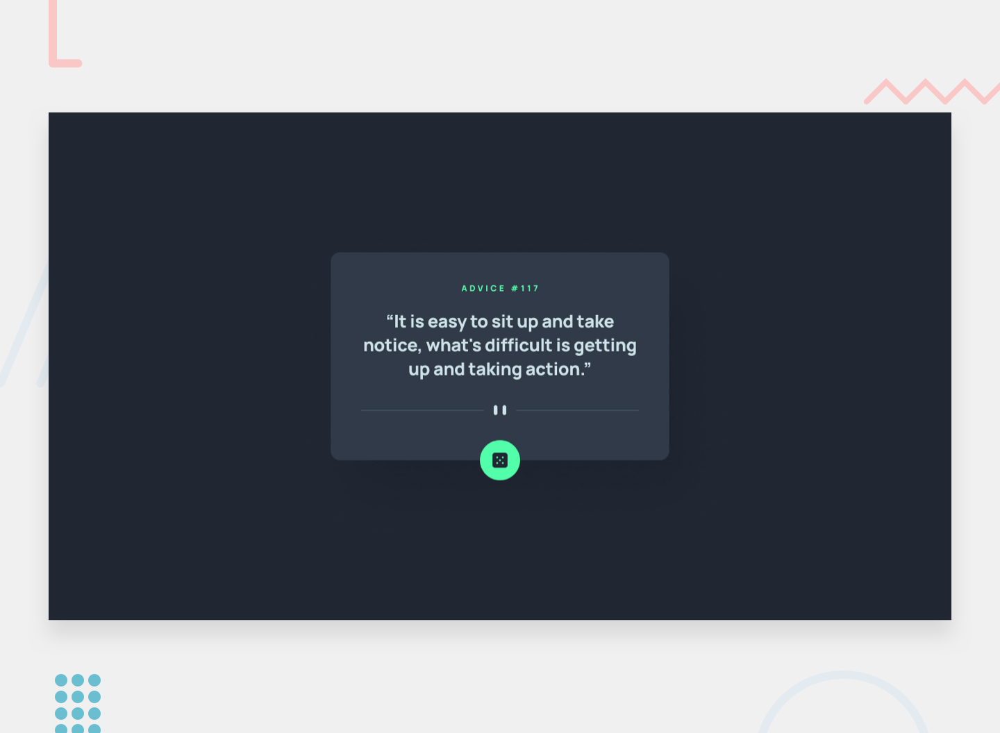

# Frontend Mentor - Advice generator app solution

This is a solution to the [Advice generator app challenge on Frontend Mentor](https://www.frontendmentor.io/challenges/advice-generator-app-QdUG-13db).



## Overview

### The challenge

Users should be able to:

- View the optimal layout for the app depending on their device's screen size
- See hover states for all interactive elements on the page
- Generate a new piece of advice by clicking the dice icon

### Features

- Fetches random advice from the [Advice Slip API](https://api.adviceslip.com)
- Bypasses the API's response cache so every click returns new advice
- Loading state (spinning dice) and a friendly error message if the request fails
- Responsive divider image via `<picture>`, keyboard-accessible dice button
- Respects `prefers-reduced-motion`

## Built with

- Semantic HTML5
- CSS custom properties, Flexbox and Grid
- Vanilla JavaScript (`fetch` with `async`/`await`)

## Running locally

No build step is needed. Open `index.html` in a browser, or serve the folder:

```bash
npx serve .
```

## Author

- GitHub - [@toubayes](https://github.com/toubayes)
- Frontend Mentor challenge by [Frontend Mentor](https://www.frontendmentor.io)
